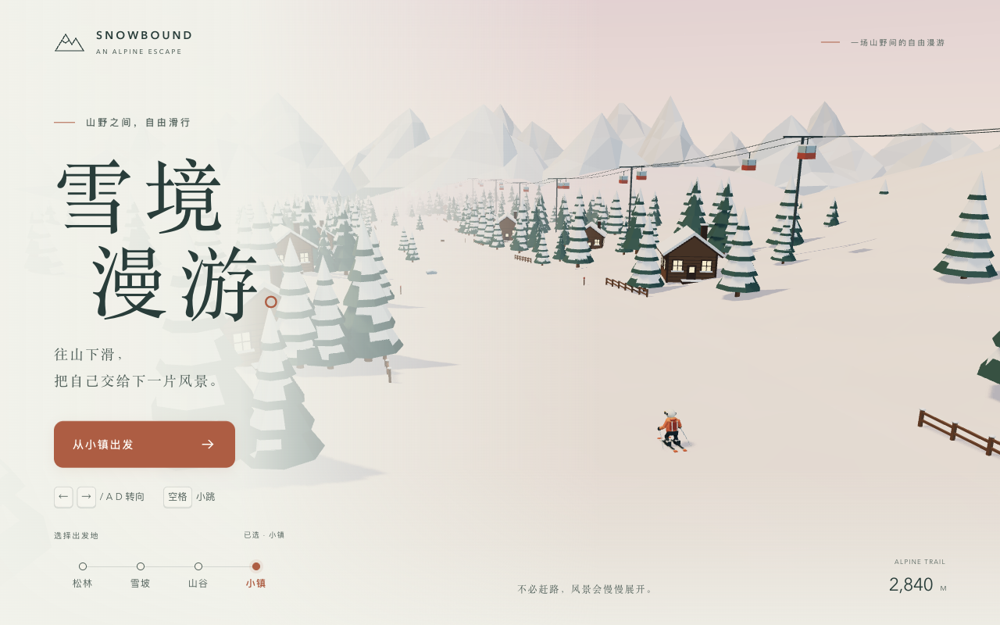

# 雪境漫游 · Snowbound

一款安静的 Three.js 3D 滑雪小游戏。选择清晨松林、开阔雪坡、冰蓝山谷或暮色小镇出发，在连续雪道中转向、跳跃、避开障碍。



## 直接预览与二次开发

模板已包含静态产物，**无需安装依赖即可通过 HTTP 服务游玩**。在模板目录运行：

```bash
python3 -m http.server 5178 --bind 127.0.0.1
```

浏览器打开 `http://127.0.0.1:5178/`。也可以把模板目录作为仓库子路径提供静态访问；产物资源使用相对 URL。不要直接用 `file://` 打开 ES 模块。

开发使用 Node.js 22 LTS 或更新版本：

```bash
npm ci
npm run dev -- --port 5177
npm test
npm run build
npm run preview -- --port 5178
```

- `index.template.html` 是源码入口，开发服务器自动映射首页到它。
- `index.html`、`assets/` 和根 `favicon.svg` 是已提交的生产产物；`npm run build` 同步更新它们及 `dist/`，修改源码后必须重新构建并提交产物。
- 开发服务器不会覆盖生产入口，`npm run preview` 预览 `dist/`。
- Three.js 已编译进本地 JS；程序化几何与特效无外部模型、图片、在线字体、API Key 或 CDN 运行依赖。
- 开发者复用任务说明见 [PROMPT.md](PROMPT.md)。

## 操作

| 操作 | 键盘 / 鼠标 | 触屏 |
| --- | --- | --- |
| 出发地 | 首页四个单选控件，支持 Tab / 方向键 | 点击松林、雪坡、山谷、小镇 |
| 转向 | A / D、← / →，或按住画面横向拖动 | 左右拖动，松手停止输入 |
| 小跳 | 空格；窄屏按钮也支持 Enter / 空格 | 右下角「小跳」 |
| 暂停 / 继续 | Esc、暂停及继续按钮 | 暂停及继续按钮 |
| 重开 | R、重新开始、再滑一次 | 重新开始、再滑一次 |
| 换地点 | 暂停或结算面板「换个地点」 | 同左 |

自动下坡，12 m/s 平滑加速至 22 m/s，带轻微循迹辅助。可跳过低矮岩石与木桩，松树需要绕行；碰撞先播放摔倒动作，再展示本局距离。失去窗口焦点自动暂停。每次出发的前 100 m 无障碍，本局距离从 0 开始，重开保留选择并更换路线种子。

## 连续的四片风景

每区 760 m，末尾 180 m 是渐变带，区域名称在渐变过半时更新。下一片风景按照物体所在绝对里程在远处生成，地形、植被、岩壁、房屋、天空、雾与灯光平滑衔接；四区后循环。

| 区域 | 景物 | 可选出发绝对里程 |
| --- | --- | --- |
| 清晨松林 | 覆雪松树、冷蓝晨光、轻雪 | 0 m |
| 开阔雪坡 | 稀疏林地、层叠远山、雪面闪光 | 856 m |
| 冰蓝山谷 | 岩壁、冰面、冰瀑、薄雾；冰面惯性稍大 | 1,616 m |
| 暮色山间小镇 | 暖窗木屋、围栏、炊烟、移动缆车 | 2,376 m |

地形每段 64 m，正常保留 12–13 段，前方加载、后方释放。景物使用共享几何和 InstancedMesh；粒子使用固定池，双雪痕使用环形缓冲。窄屏降低粒子、像素比与阴影预算，持续慢帧会进一步降低画质。

## 文件导航

```text
index.template.html / src/style.css   界面、状态容器和响应式样式
src/main.js                          游戏循环、输入、状态机、相机与画质
src/course.js                        路线、区域、障碍布局与碰撞
src/world.js                         流式地形、实例化景物、冰面与缆车
src/scenery.js / src/skier.js         景物与角色几何和动作
src/effects.js                       飘雪、雪粉、轨迹、雾、烟、闪光
tests/course.test.js                 7 项路线与碰撞测试
scripts/build.mjs / vite.config.js   可复现的开发 / 静态构建入口
QA.md / screenshots/                本次浏览器验证与截图证据
PROMPT.md                            开发者复用说明
licenses/three-LICENSE.txt           Three.js MIT 完整许可
preview/cover.png / preview/video.mp4  画廊素材，非运行依赖
```

## 验证与限制

7 项 Node 测试通过，生产构建通过。浏览器覆盖桌面 / 窄屏、四个出发地、键盘和指针输入、跳跃越障、碰撞、重开、暂停、区域循环与 WebGL 恢复；记录见 [QA.md](QA.md)。生产构建不包含开发调试桥 `window.__snowbound`。

Vite 提示主 JS 超过 500 kB（Three.js 单包，gzip 约 146 kB），是体积告警，不是构建失败。游戏需要 WebGL 2 和硬件加速。实体手机、Safari / Firefox 性能尚未实测；桌面窄屏模拟不代表手机性能。UI 支持减少动态效果设置，但主动开始后的实时滑雪仍有运动。

这是本地单人小游戏，没有账号、后台、多人、联网排行榜、成绩持久化或音轨。景物是原创程序化示意，不对应真实雪场。

## 画廊素材

`preview/cover.png` 与 `preview/video.mp4` 取自本次提交生产版本的真实 Chrome 运行画面，比例一致。视频展示首页选择小镇、开始滑行及跳跃；录制保留真实碰撞规则，未用开发定位或关闭障碍。H.264、无音轨、faststart；具体规格及浏览器播放检查见 QA。

素材仅供画廊展示，网站代码不引用 `preview/`。模板以 `snowbound` 登记在根 `catalog.json` 的 `games` 分类。PR 合并后，由目标 Studio 环境负责人将 `STUDIO_TEMPLATE_REF` 更新为包含目录、源码和素材的已合并完整 SHA，并完成真实画廊验收。该环境与负责人由维护者确认；本 PR 不执行环境发布。

## 许可与署名

- 应用代码许可未单独指定，沿用仓库的说明方式。
- Three.js 0.180.0：MIT，完整许可见 [licenses/three-LICENSE.txt](licenses/three-LICENSE.txt)。Vite 仅用于构建。
- 角色、树木、木屋、地形与特效均为原创程序化几何，无第三方模型、照片或字体文件。
- 封面与视频是同一应用的真实浏览器截图和录制，不含无关桌面内容。
